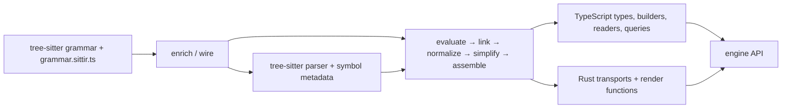

# sittir

Sittir derives typed TypeScript syntax APIs from tree-sitter grammars: constructors, readers, kind guards, query facets, immutable updates, and native renderers. The same grammar model determines the construction types and the code that renders their values.

The node API follows the grammar's concrete forms. Parsed nodes retain source identity for unchanged regions; constructed and edited regions render through generated Rust code. This supports both syntax construction and source-to-source transformation without maintaining a separate handwritten AST library for each language.

## Examples

### Construct syntax

```ts
import { createEngine } from '@sittir/common';
import rust from '@sittir/rust';

const engine = await createEngine(rust);
const fn = engine.build.statement.function({
	visibilityModifier: 'pub',
	name: 'main',
	parameters: engine.build.parameters(),
	body: engine.build.block()
});

fn.$render(); // "pub fn main() {}"
engine.dispose();
```

The ordinary builder resolves ergonomic inputs such as strings in node slots. Its `.strict` entry accepts the explicit grammar-derived construction shape. Both produce the same node family.

### Transform a parsed tree

```ts
import { createEngine } from '@sittir/common';
import rust from '@sittir/rust';

const engine = await createEngine(rust);
const source = 'fn greet( ) { /* retained */ }\n';
const root = engine.parse(source);
const statements = root.statements().map((node) =>
	engine.is.functionItem(node)
		? node.$with.name(engine.build.identifier('hello'))
		: node
);
const updated = root.$with.statements(...statements);

root.$render() === source; // true
updated.$render(); // "fn hello( ) { /* retained */ }\n"
engine.dispose();
```

Accessors and guards are grammar-specific and statically typed. `$with` produces an updated value; it does not mutate the parsed tree or propagate a child replacement into its ancestors. Rebuild the containing slots, as above, to obtain an updated root.

## Architecture



The grammar entry executes in both tree-sitter's generation environment and Sittir's evaluator. Parser-issued kind identities and authored structure are carried through the compiler model; emitters consume those facts rather than independently reconstructing grammar intent.

| Layer | Responsibility |
| --- | --- |
| `@sittir/types` | Shared type projections and engine contracts |
| `@sittir/codegen` | Grammar evaluation, canonical model, TypeScript and Rust emission |
| `@sittir/common` | Engine binding, node lifecycle, queries, and the native boundary |
| Grammar packages | Language descriptors, generated types, and native bindings |
| `sittir-core` | Native parsing, typed reads, source/layout handling, and rendering |
| `@sittir/cli` / `@sittir/tools` | Generation, diagnostics, corpus validation, and regression gates |

The runtime is native-only. Each grammar package contains its own N-API binding; a missing or incompatible binding is an error. Generated files are derived artifacts: grammar changes belong in `grammar.sittir.ts`, and compiler changes belong in codegen.

[Architecture](docs/architecture.md) covers the model, generated artifacts, and runtime boundaries in more detail.

## Grammars and installation

The workspace includes Rust, TypeScript, Python, regex, and tree-sitter query syntax (SCM). They use the same engine contract, with types and construction paths derived separately for each grammar.

```sh
pnpm add @sittir/common @sittir/rust
```

Substitute the grammar package you need. For a source checkout, use the [development setup](DEVELOPMENT.md) to build the native bindings.

Sittir is alpha software. Grammar-derived shape checks and lexical guards constrain construction; they do not establish a program's semantic validity. Corpus validation tracks supported construction and round-trip behavior, including known exclusions.

## Documentation

- [Usage guide](docs/use-cases-and-examples.md) — construction, parsing, queries, updates, rendering, and types
- [Examples](examples/README.md) — runnable modules and generated reconstruction fixtures
- [Development](DEVELOPMENT.md) — setup, commands, regeneration, and verification
- [Documentation index](docs/README.md) — reference material and explicitly planned work
- [Contributor and agent instructions](CLAUDE.md)

## License

MIT
