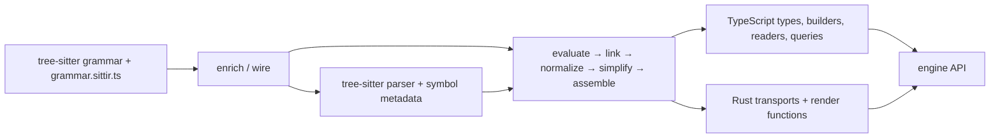

# sittir

Sittir derives typed TypeScript syntax APIs from tree-sitter grammars: constructors, readers, kind guards, queries, immutable updates, and native renderers. One grammar model determines the construction types and how their values render; parsed nodes retain the original bytes of unchanged regions.

Language tooling typically offers three surfaces that do not compose into a shared contract.
Parser/CST libraries expose untyped syntax trees without construction or rendering.
Pattern engines such as ast-grep and Semgrep provide matching with template-string rewrites.
Typed AST libraries such as Babel, LibCST, and syn maintain a separately authored model and implementation for each language.
Sittir uses tree-sitter as its base because it supplies explicit grammars, fields, symbol metadata, and incremental parsing across languages.
It derives the missing typed construction/read/edit/render surface from that structure and a small authored overlay.
Sittir complements ast-grep's pattern matching rather than replacing it.

**Syntactically valid by construction.** Generated types enforce required slots, admitted kinds, and multiplicity (`repeat1` becomes a non-empty tuple); leaf text is checked at runtime against the grammar's patterns and applicable reserved words. Within the supported construction surface, a built tree conforms to the language's syntactic grammar as Sittir's generated parser encodes it (the upstream tree-sitter grammar plus Sittir's authored structure), so it parses back unchanged. Static-semantic rules are out of scope: ECMAScript's Early Errors and analogous checks after parsing, including `break`/`continue`/`return`/`await`/`yield` contexts, labels in scope, strict-mode rules, and duplicate parameters. Upstream grammars can also over-accept relative to the language; Sittir authors grammar-production rules where it finds such gaps.

## Examples

### Construct syntax

```ts
import rust from '@sittir/rust';

using engine = await rust.createEngine();
const fn = engine.build.statement.function({
	visibilityModifier: 'pub',
	name: 'main',
	parameters: engine.build.parameters(),
	body: engine.build.block()
});

fn.$render(); // "pub fn main() {}"
```

The ordinary builder resolves ergonomic inputs such as strings in node slots. Its `.strict` entry accepts the explicit grammar-derived construction shape. Both produce the same node family.

### Transform a parsed tree

```ts
import rust from '@sittir/rust';

using engine = await rust.createEngine();
const source = 'fn greet( ) { /* retained */ }\n';
const root = engine.parse(source);
const statements = root.statements().map((node) =>
	engine.is.functionItem(node)
		? node.$with.name(engine.build.identifier('hello'))
		: node
);
const updated = root.$with.statements(...statements);

root.$render() === source; // true
updated.$render(); // "fn hello( ) { /* retained */ }\n"
```

Accessors and guards are grammar-specific and statically typed. `$with` produces an updated value; it does not mutate the parsed tree or propagate a child replacement into its ancestors. Rebuild the containing slots, as above, to obtain an updated root.

### Query a parsed tree

```ts
import rust from '@sittir/rust';

using engine = await rust.createEngine();
const root = engine.parse('fn _first() {} fn ordinary() {} fn __internal() {} fn _second() {}');
const names = Array.from(
	root.$query().$descendants.ofType(engine.kinds.FunctionItem)
		.where((c) => c.name.match(/^_/).and(c.name.match(/^__/).not()))
		.map((fn) => engine.render(fn.name()).toString())
);

names.length; // 2
names.join(', '); // "_first, _second"
```

`where` records conditions over typed slot facets (`c.name`); `map` reads the matched nodes through their ordinary accessors. This selects functions whose names start with one underscore and excludes names starting with two.

## Architecture



The grammar entry executes in both tree-sitter's generation environment and Sittir's evaluator. Parser-issued kind identities and authored structure are carried through the compiler model; emitters consume those facts rather than independently reconstructing grammar intent.

| Layer | Responsibility |
| --- | --- |
| `@sittir/types` | Shared type projections and engine contracts |
| `@sittir/codegen` | Grammar evaluation, canonical model, TypeScript and Rust emission |
| `@sittir/common` | Engine binding, node lifecycle, queries, and the native boundary |
| Grammar packages | Language descriptors, generated types, and native bindings |
| `sittir-core` | Native parsing, typed reads, source/layout handling, and rendering |
| `@sittir/cli` / `@sittir/tools` | Generation, diagnostics, corpus validation, and regression gates |

The runtime is native-only. Each grammar package contains its own N-API binding; a missing or incompatible binding is an error. Generated files are derived artifacts: grammar changes belong in `grammar.sittir.ts`, and compiler changes belong in codegen.

[Architecture](docs/architecture.md) covers the model, generated artifacts, and runtime boundaries in more detail.

## Hypothesis and goals

Sittir tests whether a tree-sitter grammar plus a small authored overlay determines a complete typed construction/read/edit/render API, without handwritten per-kind implementation code. The claim would fail if language constructs or syntactic constraints cannot be represented without such code, or require a second independently maintained account of the same syntax.

Measure each grammar through coercion (`from`), coverage, read/render/reparse and AST agreement, factory and IR storage, and built-tree render/reparse validators. Also assess generated-output determinism and the size of the authored overlay relative to the generated surface. Known gaps bound the supported surface; completeness is a hypothesis being tested.

One pipeline across languages makes those comparisons meaningful. Render fidelity takes priority over ergonomics; determinism makes output changes reproducible, and DRY makes contradictory derivations a correctness defect. Run `pnpm run validate:native` and inspect `pnpm run validate:history`; [Development](DEVELOPMENT.md) lists the validation and regeneration commands.

## Grammars and installation

The workspace includes Rust, TypeScript, Python, regex, and tree-sitter query syntax (SCM). They use the same engine contract, with types and construction paths derived separately for each grammar. Install only the language package with your preferred package manager; for example:

```sh
npm install @sittir/rust
```

Substitute the grammar package you need. For a source checkout, use the [development setup](DEVELOPMENT.md) to build the native bindings.

Sittir is alpha software. Corpus validation tracks supported construction and round-trip behavior, including known exclusions.

## Documentation

- [Usage guide](docs/use-cases-and-examples.md) — construction, parsing, queries, updates, rendering, and types
- [Examples](examples/README.md) — runnable modules and generated reconstruction fixtures
- [Development](DEVELOPMENT.md) — setup, commands, regeneration, and verification
- [Documentation index](docs/README.md) — reference material and explicitly planned work
- [Contributor and agent instructions](CLAUDE.md)

## License

MIT
