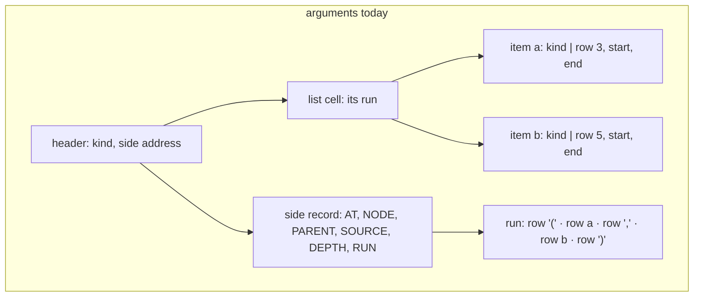
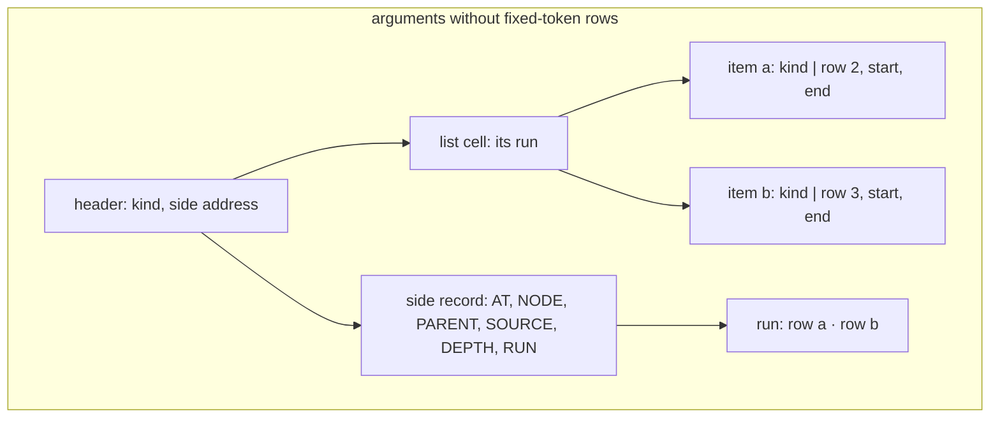
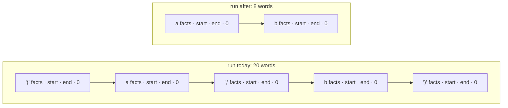

# A parsed read stores no row for a fixed token

**Status:** draft for the maintainer, 2026-11-17. Written by the engine-api session from the coordinate census (`docs/superpowers/probes/2026-11-17-read-coordinate-census/`) and the code on the hydrate-at-parse branch at `1f0170702`. Entries marked "to verify" are checked by a probe or parity test before they are built. This is the task after the hydrate-at-parse branch lands. The release of parsed records (held until this spec is written) is ruled with it.

## Decided by the maintainer

- **"Fixed token rows removed entirely"** (2026-11-17), with **"Since we are no longer preserving white space that really needs to go"** (2026-11-17, read beside the census). Removal is the requirement; this spec says how.
- **"Automatic semicolons aren't fixed tokens! They are in a choice block and that should be encoded by kindId"** (2026-11-17).
- **"fixed token is what isn't a slot or trivia or a leaf"** (2026-11-17): the census classes tokens by role, not by token class.
- **"Yes, unit rows go too"** (2026-11-17, open question 1): a unit in a slot is held by its cell's kind id alone and has no row, so a parsed unit cell is the built unit cell. The addon's `siblings` gives a unit sibling no span, and a side placed on a unit is keyed by its site.
- These standing rulings bind every choice below:
  - **A parsed node does not behave differently from a built node** (2026-11-15).
  - **"it would be whatever matches built nodes"** (2026-11-16): where a form is open, the form a built node already uses decides it.
  - **"there should be no 'parse' side channel of data not captured within the materialized nodes"** (2026-11-12).

## Terms

Every term here is used as `docs/superpowers/probes/2026-11-17-read-coordinate-census/README.md` § Roles defines it. A parse's token has one of three roles, depending on its parent kind:

- **Slot content.** What a slot of the parent holds, in a cell of the parent's record. That's a child node, a variable-text leaf (`pattern` or `lexedPattern` in `node-model.json5`), or a unit whose kind id is the slot's value.
- **Trivia.** An extra: a comment, `ERROR` or a line continuation.
- **Fixed token.** The rule's own literal text that no slot holds and the render template writes. That's a `text`, `tokenSeam`, `indent` or `dedent` part of the kind's body in `render-bodies.json`, or a separator a list writes between its items.

A **row** is a run entry for a node with no record: `RunEntry::Row { facts, span, inner }` in `rust/crates/sittir-core/src/arena/side.rs`. It takes 4 words, or 5 when the node is shown as an alias. A **record entry** is `RunEntry::Record { at, shared }`, 2 words. A **unit** is as `docs/superpowers/specs/2026-10-01-shared-arena-design.md` § Units defines it: "a kind with one fixed text and nothing else to hold".

## The end state

- A parse writes a row only for slot content that is text the source carries (a variable-text leaf, or a node with no record holding one), and for what lies under trivia. It writes no row for a fixed token. It writes none for a unit either.
- A fixed token's text comes from its kind. Where it sits comes from its holder's render body and the record's cells, the way a built node's template answers it. No byte offset of a fixed token is stored.
- A slot whose content is a choice among units is held by its cell's kind id alone, parsed and built alike.
- A record's own coordinate (`AT`: kind, start, end) stays, and so does every offset of text the source carries.
- No reader of a parsed tree asks a fixed token's offset. Each of the four readers that do today asks a position, an order or a small fact stored at parse instead.

## What a parsed record holds

The layout today, from `record.rs` and `side.rs` on the branch, for typescript `f(a, b)`. The record of `arguments` holds a list cell; each item is a leaf cell naming its row. A cell's row is 1 for the holder's own node, else the entry's index in the holder's run plus 2.

The run, word by word:

Rows' entry numbers change. A cell names its row by the written entry, so the walk numbers entries as it writes them (see § Comment seating at parse).

## Slots held by a kind id alone

Every slot whose content is a choice among units is encoded by the cell's kind id. A unit's text is its kind's. The shared-arena spec says so for every unit: "Its text is its kind's, which the render writes." A unit's identity is its place: "A unit's identity is its site: its holder, its slot's word and its item in that slot" (same section). So a unit needs no row to say what it is or which one it is. A row adds only the unit's byte offsets, and no reader needs those once the four readers below change.

| class (node model) | what the cell holds | why no row |
|---|---|---|
| keyword unit (`keyword`), including a boolean slot's keyword (`"storage":"boolean"`) | the keyword's kind id; for a boolean slot, the slot's flag | the text is the kind's, the place is the site |
| punctuation or enum unit (`punctuation`, `enum`), including an enum member that a node with no record holds (`string` in `predefined_type`) | the member's kind id, which is the unit variant `EngineGrammar::unit_id` names | the enum kind is the slot's type; the member's text is its kind's |
| external-scanner unit (a unit in `.sittir/src/grammar.json` `externals`, such as typescript's `_automatic_semicolon`) | its kind id | zero-width: its text is its kind's, which is empty in the source and `"\n"` in a render (`Kid::holder`'s doc) |
| `MISSING` unit | the kind id of the unit the parser inserted | the source holds no text for it; its holder's `HOLDS_ERROR` fact stays (see § ERROR, header-only records, zero width and MISSING) |

The trailing-separator and automatic-semicolon cases read the cell's kind, not a row's width: whether a token has width is a fact of its kind.

A parsed unit cell then holds the kind alone. That is the cell a built record already writes for a unit ("A builder takes a unit as its kind id ... and stores the kind in the holder's cell"). Parsed and built unit cells become one form.

Unit rows are slot content, not fixed tokens, so removing them goes beyond the ruling as worded. They are listed separately in the numbers and in the open questions.

## What navigation lists

Navigation (`Nodes` over `RunNodes`, `rust/crates/sittir-core/src/arena/run_nodes.rs`) lists a parsed node's children from its run. After the change it lists:

- every record (child nodes with a record, trivia records);
- every row: a variable-text leaf, a node with no record, and what lies under trivia;
- if unit rows go, each unit as its cell lists it, with its kind and no span. A built record lists its units the same way (`arena/built.rs::Engine::descendants_of` yields `QueryItem::Unit`). Where a unit sits among the run's entries is the second open question.

It lists no fixed token. Named fixed tokens leave navigation too: these are polymorph forms whose kind fixes a named node. The census counts them, as rows the render body writes that tree-sitter names:

| holder > token | rows |
|---|---|
| typescript `object_type_content` > `automatic_semicolon` (a separator choice, see below) | 25,288 on next.js |
| `method_definition_getter` > `formal_parameters` (a getter's `()`) | 647 on matter.js, 125 on next.js |
| `type_query_call_expression` > `import` | 528 on next.js |
| python `_simple_statements` > `newline`, and `indent` and `dedent` under the blocks | 442, and 165 each, on paired python |
| `receiver_parameter_declaration` > `this` | 80 on matter.js, 79 on next.js |
| rust `self_parameter` > `self`; `*_mut` forms > `mutable_specifier`; doc-comment markers | at most 151 a corpus |

Today a query already passes over them: `ParsedTree::descendants` (`engine.rs`) skips a child its holder's read routes to no slot, and an unnamed one. To verify per kind: query results on every fixture are equal before and after.

## The four readers

Every reader takes a fixed token's offsets through navigation's `Kid`, which `RunNodes::kids_of` builds from a row. The placer, `Lookups::assigned`, `Lookups::region_depth`, `Lookups::baseline_gap` and `source_items` are deleted with placement (parsed-comments spec, steps 3 and 4). These four survive.

### Spacing boundaries: `Lookups::edge_levels`

- **Today.** `nodes::for_each_edge_child` walks from a node to the child at its edge, level by level, while each starts (or ends) where its holder does. The writer then places, at that edge of a slice, what each level's template writes there (`RenderSink::boundary`). The chain often ends in a fixed token: the `(` of `arguments`, the `}` of a block.
- **After.**
  - The positional test stays for records and rows: their spans are stored.
  - Where the chain reaches a node whose edge is a fixed token, the token's kind comes from the node kind's render body: its first (last) part, read against the record's cells when that part is a slot, so the edge is the one the record's own render would write.
  - A fixed token is fixed for its kind, or for the polymorph form that is the record's kind. A choice among literal texts is a slot (a `kindEnum` or `mixedEnum` slot), so its edge is the cell's kind.
  - The per-kind leading and trailing fixed token is generated with the crate from `render-bodies.json`, the source of fixed tokens, as one fact per kind. It is never derived from text at run time.
- **Identity.** `edge_levels` tests whether the coordinate's node is this node by `kid.span() != coord.span`. That becomes a test by index: the coordinate carries its node's index.
- **Proof.** A parity test compares the levels on every fixture, for each parsed node and side, before and after.

### Depth moves: `Lookups::depth_move`

- **Today.**
  - A record's move is its side record's `DEPTH` stamp.
  - A row's move is counted over the rows inside it, by kind (`SurfaceKinds::indent`, `dedent`), plus the records inside it (`Walk::depth_move`).
  - `Lookups::depth_move` finds the node by `kid.span() == coord.span`.
- **What the census found.** Every `indent` and `dedent` row in the python corpus lies directly in a record's run: 165 of each, under `suite_block`, `block_statement`, `match_block`, `block_class_declaration` and `suite_block_class_declaration`. The hydration walk already counts the move of each child it meets from the cursor (`OpenRun::meet`), not from stored rows, and stamps the record.
- **After.**
  - A record's move is its `DEPTH` stamp, unchanged.
  - A row's move is the sum of the records inside it.
  - Generation fails if a kind whose render body holds an `indent` or `dedent` part is not read as a record. The fact is stamped where it's made and never re-derived.
  - The node is found by its index, not its span.

### A list's trailing separator: `last_list_child` (`source_trailing_delimiter`)

- **Today.** The reader takes the last child of a list that isn't an extra and has width, and the render keeps a trailing separator when the source has one. For a list with no node of its own, it takes the last child that lies inside the list's span. The width test is what tells a real `;` from an automatic semicolon.
- **After.** The fact is stored at parse, where the walk meets the tokens. It is read by kind, not width.
  - **A list whose separator is fixed** (one candidate): one bit, "the source ends this list with its separator". The census counts 19,250 such lists on matter.js and 17,950 on next.js. Today each costs a 4-word row.
  - **A list kind with several `separatorCandidates`** (typescript's `object_type_content`: `,`, `;`, `_automatic_semicolon`): the separator each gap took exists today only in its row. That's 3,088 rows on matter.js and 26,692 on next.js, 25,288 of them automatic semicolons. These kind ids are stored in the form that already holds them: `SideSlot::tokens` (`side.rs`), "the separator before each item, by its place in the slot, as a candidate kind of the list's separator, where its source spells another than the slot's" (`SlotLayout::tokens`, `layout.rs`).
    - Today the prepare walk fills it from the source (`prepare::slot_separators`). The hydration walk fills it at parse instead.
    - A trailing separator is one place past the last item.
    - The automatic semicolon is that place's kind id, as the maintainer's ruling says.
- **Where the bit lives**, beside the list's run or as a place in `tokens`, is the third open question. The parsed-comments spec keeps this half of a list slot: "The separator half is a preference choice and stays".

### Re-indenting inside multi-line tokens: `line_starts_inside_tokens`

- **Today.** The re-indent in `SpacingWriter` must not indent a line that starts inside a token. Two cases:
  - a line break inside a token's span: a variable-text leaf such as a template string or a block comment. Those spans are kept;
  - a token ending in a line break, with the next token starting at that offset, such as a string's content followed by its closing quote. Here the next token is often a fixed token.
- **After.** The second case is a fact the hydration walk knows, since it meets both tokens. It is stamped as one bit on the variable-text leaf: "the next token starts where this one ends". Where the bit sits, on the leaf's row or on its cell, is left to the plan.
  - Testing the source byte after the leaf is not used: it would re-derive with a character class what the parse knew (working standard 3).
  - The census did not count these leaves; the first step counts them.
- **Proof.** A parity test compares the line starts of every parsed node on every fixture.

## Comment seating at parse

The rule is the parsed-comments spec's and does not change.

- **Seating.** The hydration walk seats each extra by its siblings, in document order: `OpenRun::placed` in `hydrate.rs`.
  - The walk reads its siblings from its working list (`OpenRun::entries` and `beside`), which holds every token the cursor met, fixed tokens included.
  - A fixed token still counts as the "child before it" in the first rule. For example, in `a, // c` the `,` is the child before the comment.
- **What changes.** The walk keeps every token in its working list and drops the fixed tokens when it writes the run. It numbers the written entries, and a cell's row and a placed side's key name the written entry.
- **No side is placed on a fixed token.** `placed` seats a side only on a named child, and an anonymous fixed token is never named.
  - **Named fixed tokens.** For the named ones listed under navigation, a comment beside one is seated as if it were unnamed, as a built node seats it (the built form has no such child).
  - **Expected cases.** These are the only placements expected to change. The parity test lists each one: node, side, kind and span, before and after.
- **Sides on a unit,** if unit rows go, are keyed by the unit's site (holder, slot word, item). The shared-arena spec gives that key ("Sides by site"), and a built unit's sides already use it (`trivia_store::Site`). Parsed sides are keyed by row today ("each parsed tree's by row", `trivia_store.rs`).

## ERROR, header-only records, zero width and MISSING

- **Under trivia nothing changes.** An `ERROR` or an extra has no render body, so no token under it is a fixed token. Its run's rows stay as they are: 7 rows on matter.js and 6,417 on next.js. An `ERROR` renders as its source text (parsed-comments spec).
- **A header-only record** (a record with no cells, the term `admit.rs` uses): 4 on matter.js, 54 on next.js. It keeps `AT` and `SOURCE`; its text is its source slice.
- **A zero-width record** (4 on matter.js, 11 on next.js) keeps `AT`.
- **A zero-width fixed token** has no row: python's `newline` from a `tokenSeam` part, and `indent` and `dedent` from their parts (777 rows on paired python).
- **The automatic semicolon** is a cell's kind where a slot holds it: 17,627 on matter.js, 224,938 on next.js. In a separator choice it's the gap's kind id, as above.
- **MISSING.**
  - A MISSING fixed token has no row (2 on next.js).
  - A MISSING unit is its kind in its cell (4 on next.js).
  - A MISSING variable-text leaf keeps its zero-width row (1 on next.js).
  - Its holder's `HOLDS_ERROR` fact stays: `NodeFacts::of` stamps it from the tree at parse (`hydrate.rs::facts_of`).
  - The parse's error list (`error_regions`, `engine.rs`) reports MISSING regions with their holder's span. To verify on the branch: it runs over the tree's navigation, before the tree is dropped, so it does not read records.

## Public surfaces

Each row is for the maintainer before code. "Unchanged" means the value is unchanged and a parity test proves it on every fixture.

| surface | today | after |
|---|---|---|
| addon `siblings(treeId, indexes)` → `Siblings { previous, next }` of `Sibling { start, end, kind }`; JavaScript reaches it through the parsed tree's `siblings` (`packages/common/src/engine.ts`) | a unit sibling carries its row's span; a named fixed token can be a sibling where its holder's read routes no slots (`siblings_counting`, `Kid::holder`) | if unit rows go, a unit sibling has no span, as a rebuilt list's unit sibling already has none (`Sibling`'s doc); a named fixed token is no sibling |
| addon `descendants` and `readDescendants`; query facets `$children`, `$descendants` (`packages/common/src/query.ts`) | items: a node coordinate, or `QueryItem::Unit(kind)` with no span; a resume path of `ChildPosition`s indexes each level's kids | items unchanged (to verify per kind); a resume path's numbers change because a level lists fewer kids. A path is not kept across versions. |
| `NodeCoordinate.$treeHandle`, `$end` (`packages/types/src/core-types.ts`) | navigation indexes, minted as nodes are met (`Walk::meet`) | values renumber; same contract |
| `$text` | a record or leaf: its source slice; a query's unit: its kind's text | unchanged; no public surface names a fixed token, so none reads one's text |
| addon `lineStartsInsideTokens(treeId, index)` | line starts inside tokens of the node's subtree | unchanged; no caller in `packages/` |
| the parse's error list (`ErrorRegion`, `ErrorHolder`) | ERROR and MISSING regions with spans | unchanged (to verify: computed over the tree at parse) |
| `$snapshot` of a parsed node | detached plain data | to verify whether it lists a fixed token |

## What stays

- **A record's `AT`**: `[kind, start, end]`, 3 words in its side record, and its `SOURCE` word. Untouched nodes render as source slices from it ("An untouched parsed node is written as its source bytes, as today", parsed-comments spec). It is also what header-only and zero-width records hold.
- Leaf cells' spans, captured interior strings `[start + 1, end]`, and rows for variable-text leaves and nodes with no record.
- Every row under trivia.
- The read's other side-record fields.

## The one-word parsed cell

The census's other layout. Every parsed cell is one word:

- the tag word folds into the cell's word;
- a child cell `[kind, at, 0]` names its record, which gives the kind in its header;
- a leaf cell `[kind | row, start, end]` names its row, which holds the span;
- a unit cell is one word already;
- a slot that can hold a captured interior string keeps two words.

**Two stages, not one change.** The stages change different code and are measured apart:

- the row removal changes the hydration walk, navigation and the four readers;
- the one-word cell changes every parsed-cell decoder, in Rust (`Cell::decode_parsed`, the `CellWord` accessors) and in JavaScript (`record-cell.ts::decodeParsedCell`).

Neither needs the other. The row removal lands first.

Read words as a share of today, by corpus. Each row's lowest is in bold.

- **Fixed-token rows:** the stage the ruling asks for. Separators of a list kind with several candidates are left out of it, since their kind ids are stored in `SideSlot::tokens` at a cost the first step measures.
- **Plus unit rows:** that stage, with the unit rows also removed: keyword, punctuation or enum, external-scanner and boolean-slot units. It is a lower bound: the census counts the token inside an enum node with no record (for example `string` in `predefined_type`) among "a token inside a slot-held node that has no record", and does not split it out.
- **One-word cell:** that change alone.
- **Both:** the fixed-token stage and the one-word cell together.

| corpus | fixed-token rows | plus unit rows | one-word cell | both | both, plus unit rows |
|---|---|---|---|---|---|
| paired rust | 86.6 | 86.0 | 82.3 | 68.9 | **68.2** |
| paired typescript | 87.5 | 83.8 | 83.7 | 71.2 | **67.5** |
| paired python | 89.2 | 88.6 | 85.1 | 74.3 | **73.8** |
| paired regex | 94.4 | 92.5 | 80.4 | 74.8 | **72.9** |
| paired scm | 82.6 | 81.6 | 85.8 | 68.4 | **67.4** |
| `engine.rs` | 87.3 | 86.5 | 83.2 | 70.5 | **69.8** |
| `create-engine.ts` | 87.2 | 83.6 | 82.6 | 69.8 | **66.1** |
| matter.js | 83.8 | 81.2 | 84.2 | 68.0 | **65.4** |
| next.js | 86.5 | 82.6 | 83.5 | 70.0 | **66.1** |

The fixed-token rows are 16.2% of a read's words on matter.js and 13.5% on next.js. Unit rows are another 2.6% and 4.0%.

## Release under this layout

The maintainer rules release and layout together. This section says what a parsed record holds under the layout above, and how it and its source are counted and freed.

**What a parsed record holds:**

| part | what it names | counted |
|---|---|---|
| header | its kind and its side record | the side record goes with the record |
| child cell | a child's record | yes: one count, placed at parse |
| list cell | its run of item cells | the run goes with the record (one holder) |
| leaf cell, captured string | offsets into the source | no; the source is held per record (below) |
| unit cell | a kind | nothing |
| side record `AT`, `SOURCE` | the record's span, and the source's string chunk | the source: one count per side record (gap 1) |
| side record run | record entries (trivia records, and contents read from the node), and rows | record entries: as child cells; rows hold nothing |
| side record `SLOTS` | separator choices; their token runs | the token runs go with the side record |
| placed sides | comment and ERROR records, in the held-sides store | dropped where a built record's sides are |

**Rows hold no reference.** A row is facts, span and inner count, with no address. Removing fixed-token rows, and unit rows, removes offsets, not holders. The release's rules are the same under both layouts. It walks fewer run entries and frees fewer words.

**The four gaps, restated against this layout.** They are proposed and not approved (plan, "Four corrections found against the code").

1. **Who holds the source.** Every parsed side record holds it, one count per side record, added once at the end of the parse. Under this layout every stored offset still lies in some record: its `AT`, its leaf cells, captured strings and rows. Every record has `SOURCE`. Fixed tokens and units read no source at all, since their text is their kind's. So the holder set is unchanged.
   - Header-only and zero-width records hold only `AT`, and still need the count.
   - The arena-trees spec's sentence stands: "No per-tree owner, slot, table or count exists for a root, a link or a side entry to name or count."
2. **JavaScript counts a parsed record it names** through the count meta that the addon's `read(chunk)` reply carries. No layout change touches it.
3. **A link record holds its holder's record.**
   - A built cell names a parsed leaf by its holder and its row; that row is a variable-text leaf's and stays.
   - A unit is never linked: a builder stores its kind.
   - A fixed token cannot be named.
   - Under the one-word cell, the leaf cell names its row as the link does today.
4. **A parsed root's count is its handle's**, so a second release does nothing. No layout change touches it.

The cascade over a parsed record walks its parsed cells (child cells and list runs), its run's record entries that no cell names, its side record's token runs, and its placed sides. It skips rows. A record stays as the shared-arena spec has it: "records and their cells are immutable once written".

## Goals

- A parsed read stores no offset for a fixed token, and no row for one.
- The four readers answer as today on every fixture, from positions, the render body and facts stamped at parse.
- A parsed unit cell is the built unit cell (if unit rows go).
- Read words fall to the "fixed-token rows" column on every corpus, less the measured cost of stored separator choices.

## Non-goals

- Keeping source whitespace (already given up by the parsed-comments spec).
- Changing a record's `AT`, its source chunk, or the offsets of text the source carries.
- Changing built records, except that the unit cell is shared with them.
- A per-parse count, a clone on attach, or a span carried as a string-pool entry (all weighed and set aside in the plan's held-release notes).
- The one-word parsed cell, in the first stage.

## Gates

- **Read words**, as a share of today on every census corpus, by re-running the census probe, numbers compared per corpus. `deep_read_words`' two pinned fixtures (62,092 and 35,611 words today) fall, and the pin tightens.
- **Parity tests on every fixture**, before and after, with rows still written while both answers are compared:
  - edge levels, for each parsed node and side;
  - depth moves;
  - the trailing separator's kind and each gap's separator choice;
  - line starts inside tokens;
  - placed sides: node, side, kind and span;
  - query results.
- **Validation numbers** unchanged across all grammars (`sittir validate history`, compared per row). No render output is expected to change: an untouched node is its source slice, and a rebuilt one writes its template.
- **Tests that pin rows** change by design: `record_nodes.rs`'s `backers_agree`, and `arena/parsed.rs::runs_agree`, which compare the records' navigation with the tree's. They then compare against the tree with fixed tokens filtered out by role. Each one is listed and shown to pin rows before its expectation changes.
- **Parse and render timings** on CI's paired run against master's arena, per grammar. The walk does the same work and writes fewer words.

## Order

1. **Probe.** Count the leaves that need the line-start bit, and each list's trailing separators and separator choices, on every census corpus.
2. **Parity first.** The parity tests above, with the stored facts written beside today's rows and the readers answering both ways. No output change.
3. **Rows go.** The walk stops writing fixed-token rows, the readers read the stored facts, and the tests that pin rows are retaken.
4. **Unit rows go**, if the maintainer approves: unit cells take the built form, and unit sides are keyed by site.
5. **The one-word parsed cell**, as its own change.

Release (the four gaps) is built when the maintainer rules it. Its rules don't depend on which of these steps have landed.

## Open questions for the maintainer

1. ~~Do unit rows go too?~~ Ruled 2026-11-17: yes (see Decided by the maintainer).
2. **If units go, where does navigation list a unit?**
   - (a) As a built record does, from its cell, placed among the run's entries by cell order. Recommended: it matches built nodes.
   - (b) A one-word run entry holding the unit's facts word. This keeps today's order but stores the kind twice.
3. **The trailing-separator bit for a list with a fixed separator:**
   - (a) one bit beside the list's run, no words. Recommended.
   - (b) one more place in `SideSlot::tokens`: a side-slot entry, 8 words or more, for each such list.

   A separator choice uses `tokens` either way.
4. **Named fixed tokens** (`self`, `mutable_specifier`, a getter's `formal_parameters`, `this`, doc-comment markers, python's `newline`, `indent` and `dedent`) leave navigation, and a comment beside one is seated as a built node seats it. Accept?
5. **Two stages:** the row removal first, then the one-word cell, each measured. Accept, or one change?
6. **The public surface rows above.**
7. **Release:** rule the four gaps now, since this layout doesn't change their rules, or after the row removal lands?
